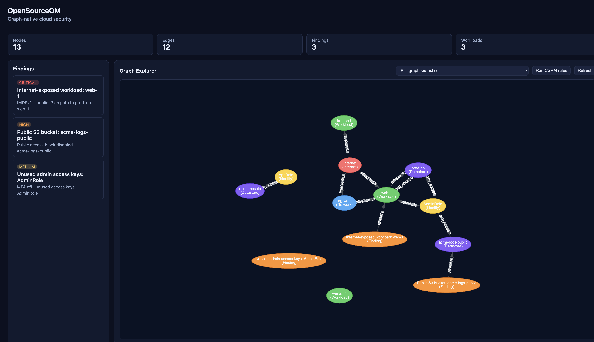

<!--
Copyright 2026 OpenSourceOM
SPDX-License-Identifier: Apache-2.0
-->

# OpenSourceOM Core

[](https://github.com/OpenSourceOM/core/actions/workflows/ci.yml)
[](https://github.com/OpenSourceOM/core/actions/workflows/codeql.yml)
[](./LICENSE)
[](https://github.com/OpenSourceOM/core/releases)
[](https://github.com/OpenSourceOM/core/pkgs/container/core)

**Self-hosted, graph-native cloud security — prioritize what attackers can actually reach.**

[](https://opensourceom.org)

The screenshot is the web console after `docker compose up` and `om scan demo` — internet-exposed `web-1` on a path to `prod-db`, plus public S3 and an over-privileged admin role.

OpenSourceOM Core is the platform behind [opensourceom.org](https://opensourceom.org): collectors that ingest cloud inventory and security signals, a graph engine that models attack paths, and APIs/UI to explore risk in context.

Traditional scanners flood you with CVEs and misconfigurations. OpenSourceOM connects the dots — showing which findings sit on paths from the internet to your sensitive data and privileged identities.

> **Status:** Phase 3 has shipped. Further rule packs stay open for contributors ([#10](https://github.com/OpenSourceOM/core/issues/10)). See the [roadmap](./docs/ROADMAP.md).

## Why this exists

CNAPP platforms demonstrated that **context beats volume**: a critical CVE on an isolated dev box is not the same as a high-severity issue on an internet-exposed path to production.

OpenSourceOM brings that graph-first model to teams that want:

- **Transparency** — inspect scoring, rules, and enrichment in code
- **Control** — run entirely in your VPC
- **Community** — extend collectors and policies without vendor lock-in

## What Core does

| Capability | Description |
|------------|-------------|
| **Security graph** | Model workloads, identities, network paths, data stores, and findings as nodes and edges |
| **Attack path analysis** | Query reachable paths — e.g. internet → CVE → prod database |
| **Risk prioritization** | Score findings from base severity plus internet reachability, a path to a datastore, and admin access |
| **CSPM** | Graph-context policy rules with prioritized findings |
| **Multi-cloud** | AWS, Azure, GCP, and Kubernetes collectors |

## Architecture

```
Cloud APIs → Collectors → Normalizer → Graph Store → API / UI
                              ↘ Rules Engine → Findings (with path context)
```

**Graph schema (v0):** nodes like `Workload`, `Identity`, `Datastore`, `Finding`; edges like `REACHABLE`, `ASSUMES`, `AFFECTS`.

Full design: [docs/ARCHITECTURE.md](./docs/ARCHITECTURE.md)

## Repository layout

```
cmd/om/              `om` CLI (migrate, serve, scan, enrich, rules, identity, export, graph, paths)
sdk/collector/       Public SDK for external collector plugins
examples/collector/  Sample plugin (`om scan plugin`)
internal/collectors/ AWS, Azure, GCP, Kubernetes, demo graph
packs/               Embedded YAML CSPM rule packs
internal/rules/      CSPM rules engine with graph-context scoring
internal/graph/      Graph schema, Postgres store, path + blast-radius queries
internal/enrichment/ CVE lookup (NVD) and severity normalization
internal/export/     Slack, SIEM, Jira exporters
internal/api/        REST API + embedded web console
migrations/          Postgres schema migrations
docs/                Architecture, roadmap, ADRs
docker-compose.yml   Local dev stack (Postgres + API)
deploy/helm/         Production Kubernetes chart
```

## Quick start

```bash
git clone https://github.com/OpenSourceOM/core.git
cd core
cp .env.example .env

# Start Postgres + API (http://localhost:8080)
docker compose up -d

# Build the CLI
go build -o om ./cmd/om

# Apply graph schema migrations
./om migrate

# Load the sample graph (no cloud credentials)
./om scan demo

# Or scan cloud / cluster inventory
export AWS_REGION=us-east-1
./om scan aws
./om scan k8s      # requires kubeconfig

# Or ingest a custom collector (stdout is a graph batch)
go build -o example-collector ./examples/collector
./om scan plugin -- ./example-collector

# Run CSPM rules (builtin graph-context + embedded packs)
./om rules list
./om rules run

# Identity blast radius
./om identity blast-radius --name AdminRole

# Enrich with CVE data that matches workload inventory.
# The demo graph lists log4j 2.14.1 on web-1 and 2.17.1 on worker-1.
# NVD matches the CPE. This catalog is the offline equivalent.
./om enrich cve --catalog examples/cve-catalog.json

# Export findings
./om export findings run --format siem --out findings.jsonl

# Open the web console (click identities for blast radius)
open http://localhost:8080
```

The API image compiles `github.com/aws/aws-sdk-go-v2/service/ec2`. Give Docker at least 6 GiB of RAM.

The console signs people in with an email and password. While no admin exists, the page asks you to create one. Keep the API port private until you do. Set `OM_ADMIN_EMAIL` when that first address should be fixed in advance. `om admin create --email you@example.com` does the same from the machine before the port is reachable.

An admin adds the next person from the console. That person gets a temporary password, shown once, and chooses their own at the next sign-in. SMTP is optional. When it is set, the temporary password is emailed, and a forgotten password can be reset from a one-hour link. Google and GitHub buttons appear only when those client credentials are set, and the provider email must match an existing admin. Every console account is an admin. Two-factor authentication is optional per admin.

An API token is created only when an admin asks for one, from the console or with `om token create --email you@example.com`. It is printed once. Collectors, CI, and `curl` send it as `Authorization: Bearer` or `X-API-Key` on every `/v1` call except health, the session probe, and logout. The CLI talks to Postgres and does not use the token. A token cannot add or remove admins. `om token rotate --email you@example.com` replaces it.

**API endpoints:** `GET /v1/health`, `POST /v1/ingest`, `GET /v1/findings`, `GET /v1/graph/snapshot`, `POST /v1/rules/run`, `GET /v1/identity/blast-radius`

**Multi-cloud scan:**

```bash
./om scan demo     # sample environment, no credentials
./om scan aws
./om scan azure    # requires AZURE_SUBSCRIPTION_ID + az login
./om scan gcp      # requires GCP_PROJECT_ID + ADC
./om scan k8s      # requires kubeconfig or in-cluster credentials
./om scan plugin -- ./my-collector
```

The CLI does not read `.env`. It defaults `POSTGRES_HOST` to `localhost`, which matches the Postgres port Compose publishes, so the host commands above reach the database. Set `POSTGRES_HOST=localhost` only if your shell already exports `POSTGRES_HOST=postgres`. For CLI-only use without the API container, run `docker compose up -d postgres`.

**Kubernetes:**

```bash
docker build -t ghcr.io/opensourceom/core:0.4.0 .
helm install om deploy/helm/opensourceom \
  --set postgres.password='change-me' \
  --set image.tag=0.4.0
```

Collectors stay off until you enable one and supply credentials, an existing Secret, or `serviceAccountAuth`. The CronJob runs `om scan` against the same Postgres the API reads. `om scan demo` stays a one-shot command. See `scan` in `deploy/helm/opensourceom/values.yaml`.

Full documentation: [opensourceom.org](https://opensourceom.org) (docs at [opensourceom.org/docs](https://opensourceom.org/docs/))

## Roadmap snapshot

| Phase | Focus |
|-------|--------|
| **0** | Graph schema v0, AWS collector, ingest API, `om` CLI |
| **1** | Attack path queries, CVE enrichment, web UI, Azure/GCP collectors |
| **2** | CSPM rules, blast radius, K8s connector, exports |
| **3** | Plugin SDK, Helm, embedded rule pack, demo graph, inventory-backed CVEs, crown-jewel datastores, attack-path findings, and cloud audit context (CloudTrail, Activity Log, Admin Activity). Shipped. |

Details: [docs/ROADMAP.md](./docs/ROADMAP.md)

## Contributing

We welcome issues, discussions, and PRs.

1. Read the [roadmap](./docs/ROADMAP.md) and [architecture](./docs/ARCHITECTURE.md)
2. Comment on an [open issue](https://github.com/OpenSourceOM/core/issues), or open a [discussion](https://github.com/OpenSourceOM/core/discussions) with the `roadmap` label before a large change that is not tracked yet
3. Keep collectors **read-only** toward cloud accounts by default
4. See [CONTRIBUTING.md](./CONTRIBUTING.md) — pull requests get an automatic [CodeRabbit](https://docs.coderabbit.ai/) review

## Related repositories

| Repo | Purpose |
|------|---------|
| [website](https://github.com/OpenSourceOM/website) | Marketing site and user docs |
| [core](https://github.com/OpenSourceOM/core) | This repository |

## Security

Report vulnerabilities to **security@opensourceom.org**. Do not open public issues for security bugs. See [SECURITY.md](./SECURITY.md).

## License

Apache-2.0 — see [LICENSE](./LICENSE).
